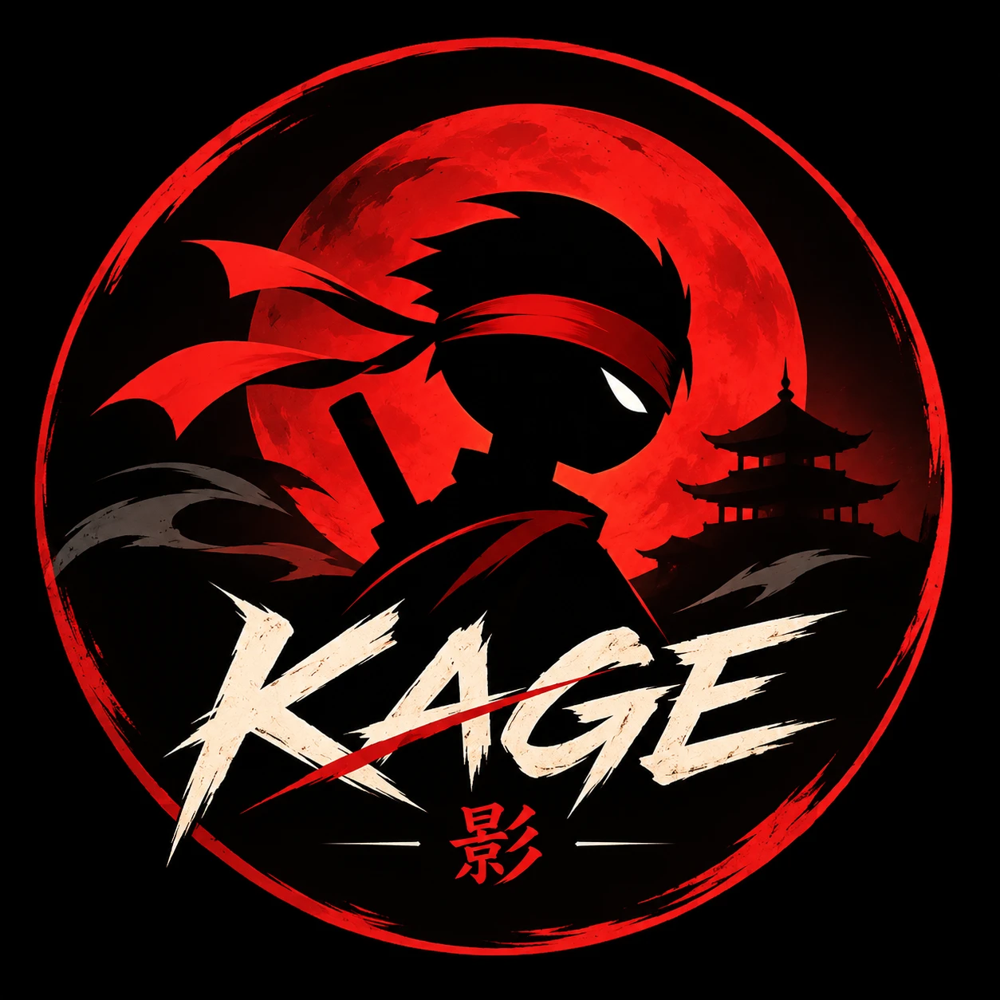

<p align="center"></p>

<h1 align="center">KAGE — Wrath of Shadow</h1>

<p align="center"><i>Step out of the shadow. Draw the blade. Answer the blood moon.</i></p>

KAGE (影, "shadow") is a cinematic 2D stickman sword-fighting game set under a crimson moon. You fight duelists, sub-bosses and three-phase masters with katanas, spears, hammers and bare hands. Elemental sword arcs, perfect parries, slow-motion finishers and a dark Japanese ink identity drive the fights.

The whole game ships as **one self-contained `index.html`**: HTML5, Canvas 2D, vanilla JavaScript and Web Audio, with no libraries. The fonts and key-art images are inlined by the build, so it runs offline and wraps easily for mobile.

- **Home screen:** the key art comes alive. The moon breathes, the hero's headband blows in the wind, his blade glows, the cracked ground smoulders and embers rise, and the 2.5D parallax layers follow your pointer.
- **Campaign:** 3 acts, each with 4 duelists, 2 sub-bosses and 1 three-phase main boss (21 fights).
- **Survival:** endless waves, a sub-boss every 5th wave, coins every wave and a gem every 5 waves.
- **Armory:** 6 weapons, 10 helmets and 9 armors. Each item can be bought, upgraded and equipped. Boss trophies are exclusive.
- **Progression:** coins, gems, XP and levels, performance ratings, honor seals, New Game+, and saves in `localStorage`.
- **Look and feel:** procedural skeletal stickmen, inverted impact frames, stamped onomatopoeia, hit-stop, trauma-based screen shake, slow-motion finishers and ink-wipe screen transitions.
- **UI:** a dark Japanese identity — brush KAGE logo, brush-stroke menu buttons, crimson and muted gold, a premium combat HUD (portrait medallions, gold-framed health bars with smooth drain, glowing rage meter, cinematic boss bar). Layout tokens started from the Wonder design file *Vole*.
- **Sword animation:** every technique runs on a timeline (anticipation → wind-up → whipping strike → follow-through → stance) with torso and hip twist, per-weapon weight, and over-extended recovery after a heavy whiff.
- **Elemental effects:** smears are built from the real blade history. Moon Katana = moon crescents, Dragon Spear = water, Mountain Cleaver = flame (with heat haze), Titan Hammer = earth shockwaves and ground shards, Twin Blades = lightning, Phantom Sickle = blood moon, bare hands = wind.
- **Cinematic moments:** perfect parry, perfect dodge (slow-motion), critical hits, combo milestones, blade clashes, boss phase transitions and a full-screen finishing slash, each with its own calligraphy mark.

---

## Run it locally

Open `index.html` in any desktop browser. Double-clicking works, because everything is inline.

Alternatively, serve the folder:

```bash
python -m http.server 5317
```

Then open http://localhost:5317.

### Editing the source

The shipped file is built from readable modules in `src/`:

| File | What lives there |
|---|---|
| `src/js/00-core.js` | constants, **SaveManager**, **AudioManager** (procedural SFX + generative music), **InputManager** (keyboard / touch / gamepad) |
| `src/js/10-data.js` | poses, move tables, **weapons**, helmets, armor, **enemies & bosses**, acts, survival, economy formulas |
| `src/js/20-fighter.js` | **Player / Enemy** `Fighter`: skeleton, pose blending, state machine, cloth physics, gear & weapon art |
| `src/js/30-combat.js` | **CombatSystem**, **WeaponSystem** (projectiles, shockwaves, dropped weapons, rage arts), **ParticleSystem** + effects |
| `src/js/40-ai.js` | enemy **AI** profiles and **BossAI** abilities / phases |
| `src/js/50-world.js` | **Renderer**: three parallax environments, title / pre-fight / result scenes, impact frames |
| `src/js/60-engine.js` | **GameEngine**: fixed 60 FPS timestep, fight sessions, rounds, survival waves, rewards |
| `src/js/70-ui.js` | **UIManager**: every DOM screen, HUD, overlays, touch controls |
| `src/js/35-vfx.js` | elemental sword smears, impacts, rings, finisher slash, heat haze |
| `src/styles.css` | identity tokens, brush buttons, HUD and all screen styles |
| `src/fonts/` | embedded fonts (inlined by the build) |

After editing, rebuild the single file. Node 18+ is required; there are no dependencies.

```bash
node build.mjs
```

---

## Controls

### Keyboard

| Action | Keys |
|---|---|
| Move | `A` / `D` or `←` / `→` (hold to break into a run) |
| Jump / double jump (flip) | `W` or `Space` |
| Punch string: jab → cross → rising uppercut | `J` |
| Rear-leg roundhouse kick; **hold to charge** a spinning side kick | `K` |
| Dash / dodge (invulnerable frames) | `L` or `Shift` |
| Block — **press just before a hit to parry** | `S` |
| Weapon string | `U` |
| Kunai (limited ammo) — **Rage art when the meter is full** | `I` |
| Grab & throw (close range) | `S` + `J` |
| Lunge punch (oi-zuki) / spinning low sweep | `L` then `J` / `L` then `K` |
| Counter-slash after a block or parry | `S` then `U` |
| Pause | `Esc` or `P` |

Menus can be navigated with the arrow keys, `Enter` and `Esc`.

### Combat notes

- **Martial technique:** every attack runs anticipation → wind-up → strike → follow-through, then returns to stance. Unarmed fighters keep a bladed guard with shuffle footwork. The katana works from chudan-no-kamae and cuts kesa-giri (diagonal), kiri-age (rising), tsuki (lunging thrust) and the nukitsuke draw counter.

- **Parry:** a well-timed block stuns the attacker and opens the weapon's counter-slash. Holding block for too long cracks your guard, which leads to a guard break.
- **Repetition:** repeating the same move loses damage, and Eryndor actively reads it and counters. After a hit, any attack button cancels into another string.
- **Knockback and juggles:** launchers juggle, heavy blows bounce enemies off walls, and some strikes **disarm**. Walk over a dropped weapon to recover it.

### Touch (phones in landscape)

Touch controls appear automatically on touch screens. They can be forced on or off in Settings.

- **Left thumb:** the movement stick. It floats by default; a fixed stick is in Settings. Push it up to jump.
- **Right thumb:** Strike (weapon), Punch, Kick, Jump, Dash, Block (shield) and the Rage diamond (kunai, or rage art when full).

### Gamepad

| Action | Button |
|---|---|
| Jump | A |
| Punch | X |
| Kick | Y |
| Dash | B / LB |
| Weapon | RB |
| Block | LT / D-pad down |
| Special | RT |
| Pause | Start |

---

## Add a new weapon

In `src/js/10-data.js`, add an entry to `WEAPONS`:

```js
storm_glaive: {
  name: 'Storm Glaive', cls: 'Polearm', tab: 'polearms', rarity: 'Rare Polearm',
  hands: 2, len: 170, stance: 'spear',            // stance from STANCES
  stats: [58, 55, 88], price: 1800,                // shown in the Armory (damage, speed, reach)
  trail: '#7fb8ff', desc: 'Sweeping lightning arcs.',
  moves: ['g1', 'g2'], air: 'sa', special: 'dragonLance', counter: 'g1',
  defs: {
    g1: { kind: 'weapon', w: { fs: 150, wa: 200 }, s: { lean: 20, fs: 70, wa: 30 },
          t: [0.1, 0.08, 0.2], dmg: 10, kb: 260, hs: 0.35, box: [20, -200, 200, 150],
          limb: 'w', snd: 'swing', hsnd: 'slash', imp: 1, next: 'g2' },
    g2: { /* ... */ }
  }
}
```

Then:

1. Map its drawing in `SHAPE` in `src/js/20-fighter.js`, for example `storm_glaive: 'spear'`, or add a new shape case in `drawWeaponShape`.
2. Run `node build.mjs`. The weapon appears in the Armory and in the pre-fight weapon dock.

Move fields:

- `t: [startup, active, recovery]`
- `box: [x, y, w, h]`, relative to the feet, facing right
- `imp`: impact tier 0–3, which drives hit-stop, shake and impact frames
- Optional: `kd` knockdown, `up` launch, `gb` guard damage, `low`, `unb` unblockable, `pull`, `shock`, `multi`, `rot`, `armor`

## Add a new boss

Add an entry to `ENEMIES` in `src/js/10-data.js`:

```js
ronin_king: {
  name: 'Sorai', title: 'the Ronin King', type: 'boss', ai: 'boss',
  weapon: 'moon_katana', helmet: 'iron_kabuto', armor: 'cloak', hp: 800, dmg: 1.2,
  build: { scale: 1.2, w: 12 }, eye: '#c9a45c', accent: '#c9a45c',
  taunt: 'Opening line', defeat: 'Defeat line', win: 'Victory line', tip: 'Defeat-screen hint',
  reward: { weapon: 'storm_glaive', item: ['helmets', 'iron_kabuto'] },
  phases: [
    { name: 'Phase one', abilities: ['lunge'] },
    { name: 'Phase two', abilities: ['teleport', 'orbVolley'] },
    { name: 'Phase three', abilities: ['moonDash', 'groundSlam'], berserk: 1, unblockable: 1 }
  ]
}
```

Then place it in a stage of an act in `ACTS`.

- **Abilities** come from `BOSS_ABILITIES` in `src/js/40-ai.js`: `lunge`, `teleport`, `smokeBomb`, `moonDash`, `clones`, `shieldBash`, `float`, `orbVolley`, `counterStance`, `barrier`, `timeAura`, `groundSlam`, `hook`, `charge`, `summon`. Write a new one with `f.startAbility({ dur, pose, update(f, world, t, dt) {...} })`.
- **Phase flags:**
  - `berserk`: faster
  - `poison`: poison trails
  - `unblockable`: breaks guards
  - `aggressive`: attacks more often
- **Boss flags:**
  - `flashEyes`: telegraphs attacks
  - `adapts`: counters spam
  - `shield`: auto-blocks frontal hits
  - `heavyArmor`: no flinch from light hits
  - `noGrab`: cannot be thrown

---

## Wrap it for Android with Capacitor

```bash
npm init -y
npm install @capacitor/core @capacitor/cli @capacitor/android
npx cap init Kage com.yourstudio.kage --web-dir www
```

Copy the game into the web directory:

```bash
mkdir www
cp index.html www/
```

Add the Android platform and open it in Android Studio:

```bash
npx cap add android
npx cap sync android
npx cap open android
```

Configure the app before building:

- **Lock landscape:** in `android/app/src/main/AndroidManifest.xml`, add `android:screenOrientation="sensorLandscape"` to the main `<activity>`.
- **Fullscreen:** optionally hide the status bar with `@capacitor/status-bar`, or use an immersive theme.

The game is already Capacitor-ready:

- **No network or asset loading:** everything is inline, so it runs offline in the WebView.
- **Touch input:** uses pointer events, blocks page scroll, includes a landscape hint, and has a large touch layout.
- **Saves and audio:** saves use `localStorage`, which persists in the WebView. Audio unlocks on the first tap.

---

## Design references and originality

The dark silhouette atmosphere follows the brief's Shadow Fight 2 direction. The impact presentation follows the IMPACT FRAME reference: inverted impact frames, stamps, shake and pop-ins. Both are used as high-level principles only.

Every character, name, weapon, environment, line of dialogue, animation and sound in KAGE is original. The UI follows the Wonder design file "Vole", with the static design stickmen replaced by the procedural fighters.

Typography uses five Google Fonts under the SIL Open Font License: Permanent Marker (brush titles), Cinzel (headings and boss names), Teko (menus and labels), Rajdhani (numbers) and a kanji subset of Yuji Boku (calligraphy marks). They are embedded inside `index.html` as data, so the game still loads nothing from the network and works offline and in Capacitor.

The elemental effects are original interpretations of elemental sword combat; no character techniques, assets or signature animations from other works are reproduced.
